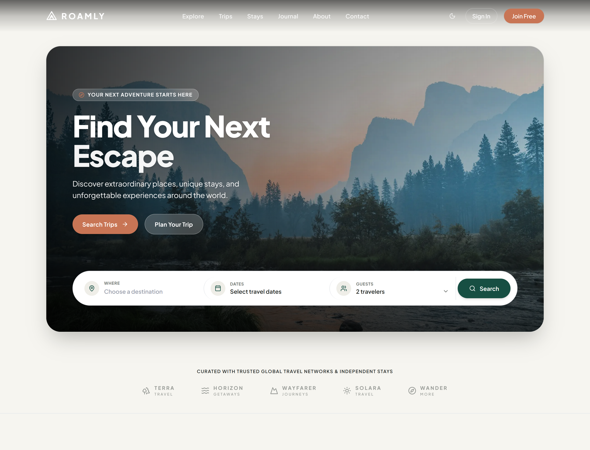
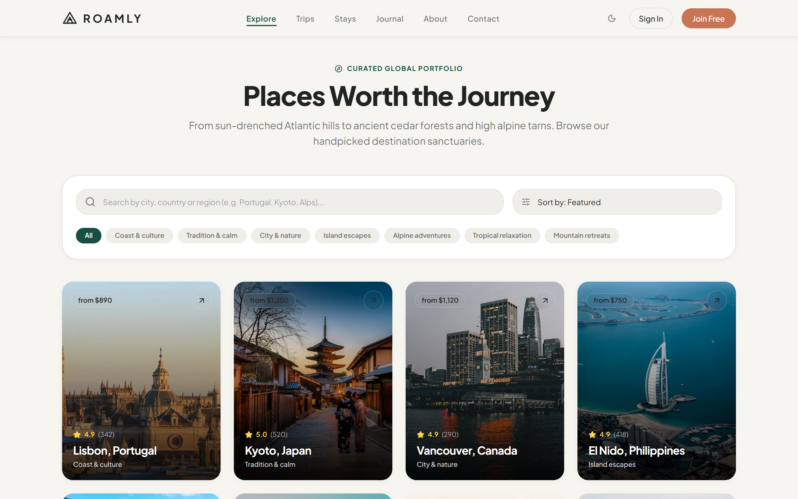
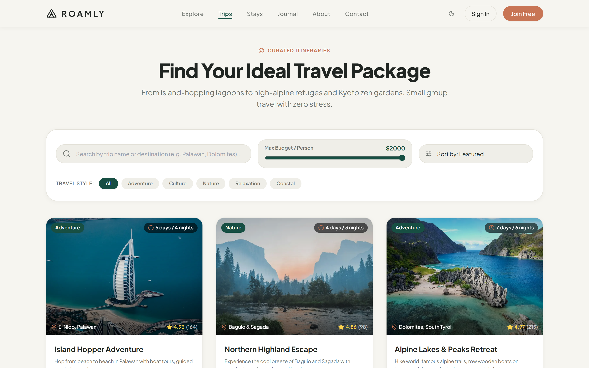
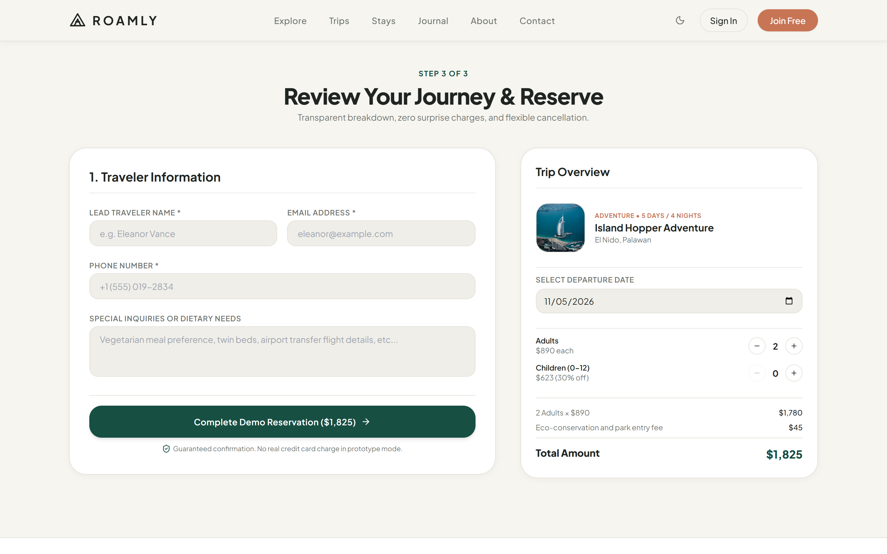

# 🌄 ROAMLY — Go Somewhere New

> A premium travel discovery and booking platform built with **Next.js 14 (App Router)**, **TypeScript**, **Tailwind CSS**, and **Framer Motion**. Inspired by editorial outdoor journals, warm neutral landscapes, and modern travel interfaces.

---

## 📸 Visual Previews

### 1. Immersive Hero & Floating Search Panel

*Scenic alpine mountain landscape, editorial typography, and interactive travel search bar with destination autocomplete, date picker popover, and guest counter.*

---

### 2. Curated Destinations Portfolio

*Filterable destination catalog featuring real-time search, category pills (Coast & Culture, Tradition & Calm, Alpine Adventures), and responsive cards.*

---

### 3. Thoughtfully Curated Travel Packages

*Detailed trip packages with live budget range slider, travel style filters, day-by-day itineraries, and transparent starting prices.*

---

### 4. Review & Reservation Flow

*Transparent pricing breakdown, interactive guest multipliers, lead traveler details form, and instant demo confirmation receipt.*

---

## 🌟 Key Features

- **Immersive Scenic Hero**: Framed panoramic alpine road composition with high-contrast typography and subtle motion reveals.
- **Advanced Travel Search Bar**:
  - **Where**: Autocomplete search with popular destination suggestions.
  - **When**: Interactive date picker with travel window validation (prevents return dates preceding departure).
  - **Travelers**: Adult and child counters with strict minimums and clear closed states.
  - **URL Persistence**: Search queries populate URL parameters (`/search?destination=...&startDate=...&adults=...`).
- **Partner Trust Strip**: Understated monochrome brand marks for fictional travel networks (Terra Travel, Horizon Getaways, Wayfarer Journeys, Solara Travel, Wander More).
- **Featured Destinations ("Top Places")**: Portrait cards with top-right arrow badges, rating indicators, and starting price pills.
- **Why Choose Roamly**: 2-column value proposition featuring curated discoveries, flexible planning, and travel statistics (50+ Destinations, 120+ Curated Trips, 15+ Guides, 4.9/5 Rating).
- **Signature Travel Packages**: Day-by-day itinerary breakdown, inclusions/exclusions, physical rating, and group size limits.
- **Travel Categories & Stays**: Alpine & Adventure, Coast & Islands, Culture & Heritage, and Wellness & Nature.
- **Stories from the Road**: Authentic traveler reviews and testimonial cards.
- **Travel Journal & Guides**: Field notes, packing advice, and slow travel articles written by regional curators.
- **Newsletter Subscription**: Client-side validated form with loading state and success feedback.
- **Light & Dark Theme**: Defaults to the warm cream light theme (`#F6F5F0`) with persistent theme toggle.

---

## 🛠️ Technology Stack

| Technology | Purpose |
| :--- | :--- |
| **Next.js 14** | React Framework utilizing App Router & Server Components |
| **TypeScript** | Strict type safety across destinations, trips, articles, and booking drafts |
| **Tailwind CSS** | Design system tokenized via custom CSS variables |
| **Framer Motion** | Controlled, accessible entrance and card hover animations |
| **Lucide React** | Clean, minimalist iconography |
| **date-fns** | Date calculations and calendar formatting |
| **next/image** | Optimized, responsive image delivery |

---

## 🎨 Design System Tokens

### Light Theme (Default)
- **Main Background**: `#F6F5F0`
- **Primary Surface**: `#FFFFFF`
- **Secondary Surface**: `#EFEEE8`
- **Primary Text**: `#202522`
- **Secondary Text**: `#6F746F`
- **Primary Brand**: `#174F43` (Deep Forest Green)
- **Primary Hover**: `#103D34`
- **Warm Accent**: `#C87555` (Terracotta)
- **Border**: `#E4E2DA`
- **Muted Icon**: `#858880`

### Dark Theme (Toggleable)
- **Main Background**: `#171D1A`
- **Primary Surface**: `#202824`
- **Secondary Surface**: `#29322D`
- **Primary Text**: `#F5F4EE`
- **Secondary Text**: `#B4B9B2`
- **Primary Brand**: `#8CBDA7`
- **Warm Accent**: `#D38A6B`
- **Border**: `#374039`

---

## 🗺️ Application Routes

| Route | Description |
| :--- | :--- |
| `/` | Complete 15-section homepage with hero, search, and catalog highlights |
| `/destinations` | Destination directory with search, categories, and sorting |
| `/destinations/[slug]` | Individual destination view with photo gallery, highlights, and climate data |
| `/trips` | Trip packages catalog with budget slider, style pills, and sorting |
| `/trips/[slug]` | Trip detail view with day-by-day timeline and sticky booking card |
| `/search` | Dynamic search results evaluating URL query parameters |
| `/experiences` | Travel styles and distinctive stays philosophy |
| `/journal` | Travel guides and editorial notes listing |
| `/journal/[slug]` | Full-length guide reading experience with author profiles |
| `/about` | Brand philosophy, sustainable travel ethos, and curator profiles |
| `/contact` | Concierge message form with feedback and FAQ accordion |
| `/booking` | End-to-end transparent price calculation and demo reservation receipt |
| `/sign-in` & `/sign-up` | Authentication interfaces with password visibility toggle |
| `/privacy` & `/terms` | Privacy policy and terms of service |
| `not-found.tsx` | Custom 404 destination lost page |

---

## 🚀 Getting Started

### Prerequisites
- **Node.js** (v18 or higher)
- **npm**

### Installation

1. **Clone the repository:**
   ```bash
   git clone https://github.com/saidulislamshehab/roamly-travel.git
   cd roamly-travel
   ```

2. **Install dependencies:**
   ```bash
   npm install
   ```

3. **Start the local development server:**
   ```bash
   npm run dev
   ```

4. **Open in browser:**
   Navigate to [http://localhost:3000](http://localhost:3000)

### Production Build & Type Checking

To verify TypeScript types and generate the optimized production build:
```bash
npm run build
```

---

## 🔒 Demonstration Note

*ROAMLY is a frontend architectural prototype. Trip bookings, prices, user authentication, and contact submissions are processed locally for evaluation and design verification.*

---

© 2026 ROAMLY Inc. Go Somewhere New.
